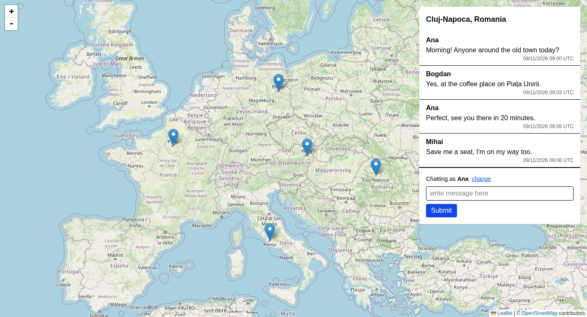
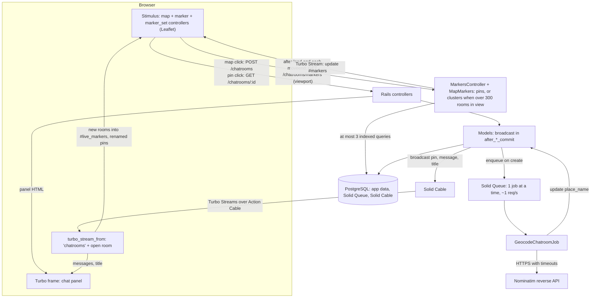

# Wolfchatter

Wolfchatter is a real-time chat app on a map. Click anywhere to drop a pin; each pin is a chatroom
anyone can join. New messages, new pins and place-name titles appear live for everyone watching,
with no reload. It is a server-rendered Rails 8.1 app on Hotwire, Leaflet with OpenStreetMap,
PostgreSQL, Solid Queue and Solid Cable: no Redis, no Node build, no SPA. The full requirements are
in the [PRD](docs/prd.md).



## Features

- **Open a room:** click anywhere on the map. A pin drops there and the panel on the right
  switches to the new room.
- **Switch rooms:** click any pin. The panel shows that room, and the URL changes to
  `/chatrooms/:id`, so links, refresh and back/forward all work.
- **Zoom:** use the +/− buttons or the scroll wheel. Double-click zoom is off, so a double-click
  can't create two rooms.
- **Chat:** enter your name once. It's remembered in a cookie, and you can change it at any time.
  Then type a message and press Submit.
- **Live:** new messages in the open room, and new pins in the part of the map you are looking
  at, appear for everyone without reloading.
- **Pins for what you see:** the map loads only the pins in view. When more than 300 rooms are in
  view, they are grouped into count badges. Click a badge to zoom in, and the badges split into
  smaller groups and finally into ordinary pins. In a grouped view, a new room raises the count of
  its group.
- **Place names:** a new room starts as "Chatroom 12". A moment later it is renamed after the place
  you clicked, for example "Cluj-Napoca, Romania", for everyone watching. A room in the open sea
  keeps its number.

## Quick start

You need Ruby 3.4.5, a local PostgreSQL your OS user can create databases in, and Chrome or
Chromium for system tests. See [Requirements](#requirements) for the details.

```sh
git clone https://github.com/ihoka/wolfchatter.git
cd wolfchatter
bin/setup --skip-server   # installs gems, creates the four databases
bin/rails test:all        # unit, integration and headless-Chrome system tests
bin/dev                   # http://localhost:3000
```

Use `bin/dev`, not a bare `bin/rails server`: only `bin/dev` runs the background jobs that set
place names (see [Run](#run)).

## Architecture at a glance



- **Two tables.** `chatrooms` (latitude, longitude, nullable `place_name`, indexed on
  `(latitude, longitude)` for the viewport query) and `messages` (`chatroom_id`, `author_name`,
  `body`), indexed on `(chatroom_id, created_at)`. A room's title is
  `place_name.presence || "Chatroom #{id}"`. Columns and limits are in the
  [PRD data model](docs/prd.md#data-model).
- **Viewport pins.** The map page renders no pins. After load and on each pan or zoom (debounced
  250 ms, stale requests aborted), the `map` controller calls `GET /chatrooms/markers` with the
  bounding box and zoom. The reply is a Turbo Stream `update` of `#markers` holding marker
  elements (data attributes only): pins when 300 or fewer rooms are in view, otherwise cluster
  elements from `MapMarkers`, a grid query. The `marker_set` Stimulus controller tells the `map`
  controller when a set arrives, and the map swaps its Leaflet layer without a gap.
- **Global `chatrooms` stream.** Every map page subscribes. Creating a room appends a hidden marker
  element to `#live_markers` (the last 20 are kept). In a pin view the `map` controller adds the
  pin if it is in view; in a clustered view it increments the count of that room's cell, or adds a
  lone pin. Pins are deduped by room id.
- **Per-room stream.** The open panel subscribes with `turbo_stream_from @chatroom`. A new message
  appends the same `messages/message` partial the page renders.
- **Place names.** Creating a room enqueues `GeocodeChatroomJob`. When it stores a `place_name`,
  the model replaces the panel title on the room stream and the marker on the global stream, so
  the pin's tooltip updates too.
- **Server is the source of truth.** The browser holds only Leaflet state and the selected room
  (in the URL). The display name lives in a signed, HttpOnly cookie.

## Key decisions and trade-offs

| Decision | Why | Trade-off |
|---|---|---|
| Hotwire over an SPA | Turbo frames give navigation and a URL per room; Turbo Streams give live updates. Four small Stimulus controllers cover the map, markers, marker sets and scrolling. No build step. | Leaflet still needs careful client code: the map is `data-turbo-permanent` and must survive Turbo visits. |
| Pins as marker elements, not JSON | Fetched pins, clusters and live pins are all server-rendered marker elements built from one partial family, delivered as Turbo Streams. There is no JSON endpoint and no client-side store to keep in sync. | Elements carry data attributes the browser must read back, which is more markup than JSON. The page no longer renders every pin: it fetches only the visible area ([Q1](docs/review/notes.md), fixed). |
| Server-side clustering, not Leaflet.markercluster | The plugin groups markers in the browser, so the server would still send every room to every visitor. That fixes the clutter but not the load. Grouping on the server in one grid query keeps the reply bounded at any room count and needs no new JavaScript dependency. | Clusters show counts only, not place names. Badges don't animate or split smoothly. See [known limitations](#known-limitations). |
| Pins or clusters chosen by count, not zoom | A fixed zoom threshold would cluster small maps for no reason. With 300 or fewer rooms in view the map shows ordinary pins at every zoom, exactly as before. | A dense area clusters even at high zoom until you zoom in far enough to hold 300 or fewer. |
| Synchronous broadcasts | `broadcast_*_to` in `after_create_commit` is a cheap Solid Cable insert. It needs no job process, and system tests see it immediately. | Broadcast rendering happens inside the request. solid_cable writes in a background thread, so a cable outage is logged rather than failing the post ([T1, refuted](docs/review/report.md#checked-and-clean)). |
| Solid Queue and Solid Cable on Postgres, no Redis | One database server to run, back up and pay for. Solid Queue runs inside Puma. | Postgres carries the job and cable load. Fine at the expected scale ([infrastructure](docs/infrastructure.md)). |
| Signed-cookie display name, honor system | No accounts were in scope. Name once, reused everywhere; the signature stops tampering with someone else's cookie. | Anyone can pick any name. Names are not unique or authenticated. |
| Per-session CSP nonce | Strict CSP with no `'unsafe-inline'`. The browser keeps the CSP header of the first full load while Turbo swaps in each page's nonce meta, so a per-request nonce would break after the first visit. | The nonce is stable for a session, which is weaker than a fresh one per request. |
| Throttled geocoding job | Nominatim's policy is at most 1 request per second with an identifying User-Agent. `limits_concurrency to: 1` plus a 1-second sleep enforces that globally, and HTTP stays out of the request. | Under a burst of new rooms, place names queue up and arrive late. |
| Rate limits | Rails `rate_limit`: 10 rooms and 30 messages per minute per IP, so one script can't litter the map or flood a room. | Per-IP only: a distributed flood is slowed, not stopped. In-memory store in development, Solid Cache in production. |

## Improvements over the mockups

- **Name entered once:** the mockups ask for your name with every message. Here you enter it once
  and it's remembered in a signed cookie.
- **Place-name titles:** rooms are named after their location instead of "Chatroom 1, 2, 3".
- **A URL per room:** each room has its own address, so rooms can be shared and bookmarked, and
  the browser's back button moves between them.
- **OpenStreetMap tiles** replace the watercolor tiles in the mockups. They need no API key, and
  the attribution stays visible.

Place names come from [Nominatim](https://nominatim.org/) (© OpenStreetMap contributors). Lookups
happen server-side in a background job. The job sends an identifying User-Agent and is throttled to
one request per second, as Nominatim's usage policy requires.

## Known limitations

- **Names work on the honor system.** There are no accounts, so anyone can pick any name.
- **History:** the panel shows the 100 most recent messages in a room.
- **Timestamps are shown in UTC.**
- **Every map click creates a room,** including stray ones. This matches the mockups.
- **No edit, delete or moderation.** Rate limits slow abuse but can't undo it.
- **Cluster counts can drift by one.** A live room can be counted twice, or the creator's own
  cluster might not be incremented, until the next pan or zoom reloads the exact counts.
- **Cluster badges can overlap.** Neighbouring badges can touch at dense zooms. The grid is fixed
  per zoom level and does not merge neighbours.
- **Cells look taller near the poles.** The grid is plain degrees of latitude and longitude, so on
  a Mercator map a cell is visually taller at high latitudes.
- **Missed pins after a dropped connection:** pins created while your live connection was down
  show up after the next pan or zoom, which refetches the view.
- **The creator can miss their room's live title.** If the place name arrives before the new
  panel's stream subscribes, the creator keeps "Chatroom 12" until they reopen the room. The pin
  still updates. The window is small.
- **Very fast Back:** pressing Back within milliseconds of clicking a pin can leave the panel
  showing the room you just opened. The next navigation corrects it. This comes from how Turbo
  finishes a frame visit.
- **Not deployed.** There is a plan and budget for fly.io in [infrastructure](docs/infrastructure.md),
  but no CI and no live environment. Tests run locally.

The deferred review findings and what we'd do next are in the [triage notes](docs/review/notes.md).

## How this was built with AI

Wolfchatter was built with Claude Code, and the process is committed alongside the code.

- **Docs before code.** A brainstorm produced the [design spec](docs/superpowers/specs/2026-11-09-wolfchatter-design.md),
  which was distilled into the [PRD](docs/prd.md) and an [overview plan](docs/plans/00-overview.md)
  with eight phases. Each phase got its own detailed plan in [`docs/plans/`](docs/plans/), written
  just before it started. The lead developer approved the plans for phases 0–2 one by one. Phases 3–7
  ran under a standing go-ahead, and the lead developer reviews the end result.
- **Subagent-driven execution.** Each task in a plan went to a fresh implementer subagent, with TDD
  and small commits. A fresh reviewer checked each task, and a whole-branch review ran before each
  phase PR. One branch and one PR per phase, merged without squashing.
- **Project rules in [`CLAUDE.md`](CLAUDE.md):** stack limits (no Redis, no Node build, no SPA),
  Hotwire first, broadcasts declared in models, no live network in tests, every N+1 is a bug,
  verify before claiming done, and a precedence order of spec > PRD > plan > conventions.
- **Three-layer `/self-review`** ([skill](.claude/skills/self-review/SKILL.md), [agents](.claude/agents/)):
  `bin/review` runs the deterministic tools; three focused reviewers look only at queries, test
  gaps and security; then an adversarial verifier tries to refute each finding before it reaches
  the [report](docs/review/report.md). The lead developer triages every finding in the
  [notes](docs/review/notes.md).

What the process caught: the phase 2 final review found a CSP nonce that would break after the
first Turbo navigation. Running the geocoder for real, outside the test suite, found a missing
`require "net/http"` that WebMock had been hiding. The verifier refuted a "broadcast failure
returns 500" claim repeated across three earlier reviews, and the final review in turn caught one
of the verifier's false positives (the 406 half of T9). No single layer catches everything.

## Development

### Requirements

- Ruby 3.4.5. The version is pinned in `.ruby-version`, which mise, rbenv and similar tools read.
- PostgreSQL running locally and reachable by your user. `bin/setup` connects over the local socket
  as your OS user, which needs a PostgreSQL role with CREATEDB (`sudo -u postgres createuser --createdb $USER`),
  or set `DATABASE_URL` / `PGHOST` / `PGUSER`.
- Chrome or Chromium for system tests. Set `CHROME_BIN` to the browser binary if it is not
  found on your `PATH`.

### Setup

```sh
bin/setup
```

This installs gems and prepares the databases, then starts the app. `bin/setup` creates four
databases: development primary (`wolfchatter_development`), development queue and cable
(`wolfchatter_development_queue`, `wolfchatter_development_cable`), and `wolfchatter_test`.
Use `bin/setup --skip-server` to set up without starting the app.

### Run

```sh
bin/dev
```

Then open http://localhost:3000. `bin/dev` starts Puma with Solid Queue running inside it
(`SOLID_QUEUE_IN_PUMA=1`) plus the Tailwind watcher.

Note: a bare `bin/rails server` enqueues background jobs but does not run them, because Solid
Queue only runs inside Puma when `SOLID_QUEUE_IN_PUMA=1` is set. Use `bin/dev`.

### Test

```sh
bin/rails test           # unit and integration tests
bin/rails test:system    # headless-Chrome system tests
bin/rails test:all       # everything
```

Coverage is off by default. `COVERAGE=1 bin/rails test` writes a report to `coverage/` for unit
and integration tests, and `COVERAGE=1 bin/rails test:all` includes system tests. Prosopite runs
in the test environment and fails tests on N+1 queries. Tests never touch the network: WebMock
blocks it and Nominatim is stubbed.

### Quality

```sh
bin/rubocop
bin/brakeman
bin/bundler-audit
```

### Review

```sh
bin/review                # Brakeman, bundler-audit, importmap audit, RuboCop, all tests with coverage
bin/review --skip-system  # the same, without system tests
```

It prints a summary table, writes raw output to `tmp/review/`, and exits non-zero if any tool
fails. In Claude Code, `/self-review` runs it as the first layer of the AI review.

## Docs

- [Product requirements (PRD)](docs/prd.md): requirements, data model, real-time design, risks
- [Design spec](docs/superpowers/specs/2026-11-09-wolfchatter-design.md): the brainstorm output the PRD came from
- [Delivery plans](docs/plans/00-overview.md): the overview and [one plan per phase](docs/plans/)
- [Infrastructure and cost estimate](docs/infrastructure.md): fly.io deployment plan and monthly costs
- [Self-review report](docs/review/report.md): verified findings from the three-layer review
- [Review triage notes](docs/review/notes.md): what was fixed, what wasn't, and why
- [CLAUDE.md](CLAUDE.md): conventions and workflow for contributors and coding agents
- [`.claude/`](.claude/): the review agents and the `/self-review` skill
